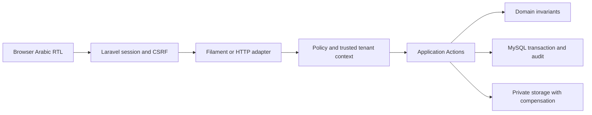

# المعمارية وخريطة المصدر

إصدار 1.0، تحقق 12 نوفمبر 2026، Issue [#71](https://github.com/NabilAlsaidaly/quality-excellence-platform/issues/71). المصدر المقروء `main@03c829fde71bbb11754ef657bf2edfe50253068e`؛ [CI بعد الدمج](https://github.com/NabilAlsaidaly/quality-excellence-platform/actions/runs/43289862828) ناجح.

المعمارية Modular Monolith عملي مع Domain values وActions. [ADR001](../adr/ADR-001-tenant-isolation.md) يفرض منظمة لكل بيانات مؤسسة، و[ADR002](../adr/ADR-002-identity-authorization.md) يفرض العضوية والتفويض المحدد والرفض الافتراضي، و[ADR003](../adr/ADR-003-identifiers-and-integrity.md) يفصل BIGINT الداخلي وULID العام. [ADR004](../adr/ADR-004-institution-identity-candidate.md) مرشح، ولا يتحول إلى قرار مقبول بمجرد اندماج الكود.

لا تُنشأ منظومة واجهة موازية: صفحات Filament تعرض وتتحقق وتستدعي Actions. شاشات `/admin/ui-preview` معاينات تاريخية، لا تثبت رحلة فعلية. تعريف لوحة العرض الاختبارية في tests/Support لا يسجله bootstrap العادي.

## جرد المجلدات من Git

| الحد | الملفات المتتبعة | المسؤولية |
|---|---:|---|
| `app/Actions` | 52 | حدود التطبيق والمعاملات |
| `app/Domain` | 27 | قيم وقواعد انتقال مستقلة |
| `app/Models` | 25 | المثابرة والربط |
| `app/Policies` | 4 | تفويض حالي |
| `app/Authorization` | 9 | سياق وإسناد وأقفال |
| `app/Filament` | 27 | عرض عربي أصلي |
| `app/Http` | 15 | طلبات ووسطاء ومحولات |
| `app/Identity` | 6 | مزودو الهوية وعزل الاستعادة |
| `app/Providers` | 3 | تركيب التطبيق واللوحات |
| `app/Jobs` | 0 | لا Jobs خاصة بالتطبيق حاليًا |
| `app/Notifications` | 1 | إشعار استعادة مؤسسية؛ لا قناة تشغيل معتمدة |
| `tests/Feature` | 49 | تحقق آلي |
| `tests/Integration/MySql` | 37 | تحقق آلي |
| `tests/Integration/Redis` | 1 | تحقق آلي |

## Actions وحدودها العامة

هذه قائمة مشتقة من التواقيع، وليست ترخيصًا لاستدعائها مباشرة عبر Tinker.

| الملف | الواجهات العامة |
|---|---|
| [ChangeApproachOwner](../../app/Actions/Approaches/ChangeApproachOwner.php) | `execute()` |
| [CreateApproach](../../app/Actions/Approaches/CreateApproach.php) | `execute()`, `withinContext()` |
| [CreateAuthorizedApproach](../../app/Actions/Approaches/CreateAuthorizedApproach.php) | `execute()` |
| [ListApproaches](../../app/Actions/Approaches/ListApproaches.php) | `execute()`, `executeAssigned()`, `show()`, `draftHistory()`, `changeHistory()`, `ownerOptions()` |
| [ManageApproachAssignments](../../app/Actions/Approaches/ManageApproachAssignments.php) | `bootstrap()`, `initialRecipients()`, `revokeQuality()`, `revokeContributor()` |
| [RecordApproachAccessDecision](../../app/Actions/Approaches/RecordApproachAccessDecision.php) | `execute()` |
| [SaveApproachContentRevision](../../app/Actions/Approaches/SaveApproachContentRevision.php) | `execute()` |
| [UpdateApproach](../../app/Actions/Approaches/UpdateApproach.php) | `execute()`, `withinApproach()`, `editToken()`, `record()` |
| [AppendDocumentVersion](../../app/Actions/Documents/AppendDocumentVersion.php) | `execute()` |
| [AuthorizedDocumentEvidence](../../app/Actions/Documents/AuthorizedDocumentEvidence.php) | `execute()` |
| [CreateDocumentWithVersion](../../app/Actions/Documents/CreateDocumentWithVersion.php) | `execute()`, `assertStandaloneWrite()`, `writeBlob()`, `validateMetadata()`, `withinContext()`, `completeWrite()`, `persistVersion()` |
| [DecideDemoDocumentAvailability](../../app/Actions/Documents/DecideDemoDocumentAvailability.php) | `execute()` |
| [DocumentFileWorkspace](../../app/Actions/Documents/DocumentFileWorkspace.php) | `intakeBoundary()`, `permits()`, `upload()`, `latestVersion()`, `canVersion()`, `decide()`, `versions()` |
| [DocumentWorkspace](../../app/Actions/Documents/DocumentWorkspace.php) | `can()`, `listing()`, `show()`, `history()`, `originalMetadata()`, `updateMetadata()`, `create()`, `append()` |
| [DownloadDemoDocumentVersion](../../app/Actions/Documents/DownloadDemoDocumentVersion.php) | `execute()` |
| [DownloadDocumentVersion](../../app/Actions/Documents/DownloadDocumentVersion.php) | `execute()` |
| [ListDocuments](../../app/Actions/Documents/ListDocuments.php) | `execute()`, `show()` |
| [ManageDocumentFileOperations](../../app/Actions/Documents/ManageDocumentFileOperations.php) | `issue()`, `revoke()`, `recordDenied()` |
| [ManageDocumentWorkspaceAssignments](../../app/Actions/Documents/ManageDocumentWorkspaceAssignments.php) | `bootstrap()`, `initializeDocument()`, `revoke()`, `recordDenied()` |
| [ProcessDocumentIntake](../../app/Actions/Documents/ProcessDocumentIntake.php) | `execute()` |
| [QuarantineTestFile](../../app/Actions/Documents/QuarantineTestFile.php) | `execute()` |
| [ReadDocumentHistory](../../app/Actions/Documents/ReadDocumentHistory.php) | `execute()`, `verify()` |
| [ReadDocumentWorkspace](../../app/Actions/Documents/ReadDocumentWorkspace.php) | `listing()`, `show()`, `history()`, `originalMetadata()` |
| [ReconcileDocumentIntake](../../app/Actions/Documents/ReconcileDocumentIntake.php) | `execute()` |
| [RegisterDocumentIntake](../../app/Actions/Documents/RegisterDocumentIntake.php) | `execute()`, `within()`, `intake()`, `documentForIntake()`, `event()`, `receipt()`, `openVerified()` |
| [ReleaseDocumentIntake](../../app/Actions/Documents/ReleaseDocumentIntake.php) | `execute()` |
| [ReviseDocumentMetadata](../../app/Actions/Documents/ReviseDocumentMetadata.php) | `execute()` |
| [BrowserAccountSession](../../app/Actions/Identity/BrowserAccountSession.php) | `end()`, `authenticated()`, `allowsRestoring()` |
| [InstitutionEntry](../../app/Actions/Identity/InstitutionEntry.php) | `login()`, `logout()` |
| [InstitutionRecovery](../../app/Actions/Identity/InstitutionRecovery.php) | `request()`, `reset()` |
| [ConfigureMaturityStage](../../app/Actions/Maturity/ConfigureMaturityStage.php) | `stage()`, `execute()`, `configuration()` |
| [DecideStageReassessment](../../app/Actions/Maturity/DecideStageReassessment.php) | `execute()`, `assertReviewBelongsToAttempt()` |
| [EffectiveMaturityState](../../app/Actions/Maturity/EffectiveMaturityState.php) | `load()`, `assertMayMutate()`, `impact()` |
| [ManageStageReassessmentOperations](../../app/Actions/Maturity/ManageStageReassessmentOperations.php) | `issue()`, `revoke()`, `recordDenied()` |
| [OpenStageReassessment](../../app/Actions/Maturity/OpenStageReassessment.php) | `execute()`, `within()`, `attempt()`, `coordinates()`, `event()` |
| [ReadStageReassessmentHistory](../../app/Actions/Maturity/ReadStageReassessmentHistory.php) | `execute()` |
| [RecordInitialStageAssessment](../../app/Actions/Maturity/RecordInitialStageAssessment.php) | `execute()` |
| [SaveStageReassessment](../../app/Actions/Maturity/SaveStageReassessment.php) | `execute()`, `configurationRow()`, `hydrate()`, `verifyEvidence()` |
| [SaveStageSubmission](../../app/Actions/Maturity/SaveStageSubmission.php) | `execute()`, `assertInitialStage()`, `hydrate()`, `verifyEvidence()`, `version()` |
| [ReviewMaturityNotifications](../../app/Actions/Notifications/ReviewMaturityNotifications.php) | `deliver()`, `inbox()`, `mark()` |
| [AuthorizedUnitOperations](../../app/Actions/OrganizationalUnits/AuthorizedUnitOperations.php) | `readMetadata()`, `tree()`, `create()`, `rename()`, `move()` |
| [InvalidHierarchy](../../app/Actions/OrganizationalUnits/InvalidHierarchy.php) |  |
| [OrganizationalUnitManagement](../../app/Actions/OrganizationalUnits/OrganizationalUnitManagement.php) | `create()`, `rename()`, `move()`, `tree()`, `withinContext()` |
| [OrganizationManagement](../../app/Actions/Organizations/OrganizationManagement.php) | `metadata()` |
| [OrganizationProvisioning](../../app/Actions/Organizations/OrganizationProvisioning.php) | `create()`, `rename()` |
| [DecideReview](../../app/Actions/Reviews/DecideReview.php) | `execute()` |
| [ManageReviewMaturityAssignments](../../app/Actions/Reviews/ManageReviewMaturityAssignments.php) | `bootstrap()`, `revoke()`, `recordDenied()` |
| [ReadReviewMaturityWorkspace](../../app/Actions/Reviews/ReadReviewMaturityWorkspace.php) | `listing()`, `show()`, `reviews()`, `evidenceOptions()`, `submissionDto()` |
| [RecordReviewMaturityAudit](../../app/Actions/Reviews/RecordReviewMaturityAudit.php) | `execute()` |
| [ReviewMaturityWorkspace](../../app/Actions/Reviews/ReviewMaturityWorkspace.php) | `approachPublicId()`, `canEnter()` |
| [SaveReviewableApproach](../../app/Actions/Reviews/SaveReviewableApproach.php) | `execute()` |
| [SynchronizeReview](../../app/Actions/Reviews/SynchronizeReview.php) | `execute()`, `target()` |
| [ApproachPolicy](../../app/Policies/ApproachPolicy.php) | `before()`, `allowsOperation()`, `viewablePublicIds()`, `viewAny()`, `create()`, `view()`, `update()`, `delete()`, `approve()` |
| [DocumentPolicy](../../app/Policies/DocumentPolicy.php) | `workspaceOperation()`, `viewAny()`, `create()`, `view()`, `update()` |
| [InstitutionAccountPolicy](../../app/Policies/InstitutionAccountPolicy.php) | `view()` |
| [ReviewMaturityPolicy](../../app/Policies/ReviewMaturityPolicy.php) | `workflowOperation()` |
| [ApproachAssignmentAccess](../../app/Authorization/ApproachAssignmentAccess.php) | `query()`, `current()`, `allows()`, `constrain()` |
| [CapabilityRegistry](../../app/Authorization/CapabilityRegistry.php) | `resourceClass()`, `requireRecognized()` |
| [DocumentWorkspaceAccess](../../app/Authorization/DocumentWorkspaceAccess.php) | `withSession()`, `within()`, `authorize()`, `query()`, `current()`, `allows()`, `constrain()` |
| [ReviewMaturityAccess](../../app/Authorization/ReviewMaturityAccess.php) | `within()`, `authorize()`, `assignments()`, `current()`, `allows()`, `structural()`, `can()` |
| [RoleManagement](../../app/Authorization/RoleManagement.php) | `list()`, `create()`, `rename()`, `syncPermissions()`, `assign()`, `revoke()`, `delete()` |
| [TenantAuthorization](../../app/Authorization/TenantAuthorization.php) | `allows()`, `authorize()`, `withinMutation()` |
| [TenantContext](../../app/Authorization/TenantContext.php) | `organizationId()`, `actorId()`, `clear()`, `verifiedFor()`, `run()` |
| [TenantTeamResolver](../../app/Authorization/TenantTeamResolver.php) | `getPermissionsTeamId()`, `setPermissionsTeamId()` |
| [UnavailablePermissionCommand](../../app/Authorization/UnavailablePermissionCommand.php) | `handle()` |

## حدود التكامل

- TenantAuthorization::withinMutation يمسك Organization X ثم Users مرتبين ثم Memberships مرتبة، ويتحقق من PDO والمعاملة حتى الالتزام. RoleManagement والوحدات وعمليات Approach المدعومة تشترك في هذا الحد. ليس بروتوكولًا عامًا لكتّاب SQL خارج التطبيق.
- ملفات الوثائق تعتمد تخزينًا خاصًا وبصمة وحجمًا وتعويض الملف المملوك عند فشل SQL؛ لا تُعامل معاملة MySQL كمعاملة ملفات موزعة.
- الإشعارات الاختبارية صفوف ذرية في MySQL، بينما Redis بنية cache/queue، وليس مصدر صلاحية أو سجل تقييم.
- لا استدعاء لشبكة مرجع مرخص أو scanner إنتاجي من مجرد وجود interface. راجع [الفحص](../../app/Services/Documents/InspectDocumentFile.php) و[حالة الإتاحة](../../app/Services/Documents/DemoDocumentAvailability.php).
