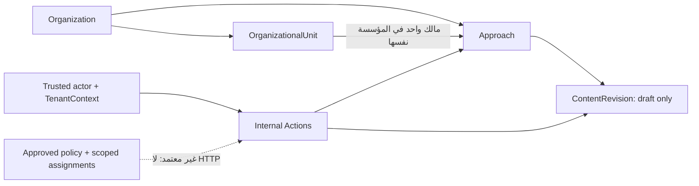

# Issue38 — خطة تنفيذ نواة بنك المنهجيات

2026-11-07، الفرع الموجود `feat/38-approach-bank-core`، الأساس المجلوب `4f996e95d65d28a5aa6f06ff302ce2a45ced4eed`. الملف التنفيذي المسمى phase6A يحدد Phase06B وIssue38. لا تفعيل واجهات أو نشر. حماية main مؤكدة من بيانات GitHub؛ تفاصيل الإنفاذ تحتاج مراجعة المالك في Settings.

## حدود المسؤوليات

مصادر التتبع العامة: BR-001..006، FR-APP-001..008/010 ومعايير AC المقابلة، ADR001/003 وثوابت منع الوصول في ADR002. ADR004 يبقى PROPOSED. مواد المالك الخاصة والتعارضات مع سجل SRS التاريخي توثق فقط في التسليم الخاص. لا ننقل نصوصها إلى المستودع العام ولا نعدّل SRS. لا تُعاد أسئلة سبق حسمها؛ سياسة D002 التشغيلية غير مصادق عليها.

## البدائل قبل المخطط

1. نص UTF-8 عادي بإصدارات: أصغر تمثيل، لا يفرض مكونات ثابتة، يُعرض escaped. لا يقدم بحثًا بنيويًا/محررًا غنيًا أو نموذج أقسام. يعتمد كخيار تقني محدود قابل للمراجعة.
2. JSON لأقسام اختيارية: يسمح بتطور البنية لكنه يتطلب مخططًا ذا إصدارات وقواعد ترقية/عرض غير محسومة. مؤجل؛ لا EAV ولا form engine. التحول لاحقًا يضيف تنسيقًا جديدًا ويحافظ على النصوص التاريخية.

## خطة الملفات المعتمدة

- الترحيلان المؤرخان 2026_11_07 فقط: approaches، approach_content_revisions. CREATE واحد ذو قيود inline لكل ترحيل لتجنب نافذة جدول بلا قيود على MySQL؛ لا triggers جديدة. BIGINT unsigned داخلي وULID خارجي، مفاتيح RESTRICT ومركبة، لا تفرد للاسم. down يرفض قبل إسقاط أي من الجدولين عند وجود منهجيات/إصدارات؛ rollback الفارغ فقط تحت توقف الكتابات. لا تراجع آلي بوجود تاريخ.
- `app/Models/Approach.php` و`ApproachContentRevision.php`: إعادة استخدام HasPublicUlid، حماية mass assignment، هوية ثابتة، منع تعديل/حذف النموذج التاريخي. raw SQL/bulk operations خارج ضمان أحداث Eloquent؛ لا ندعي تخزينًا محصنًا من المشغل.
- `CreateApproach.php`: تحقق المعطيات داخل Action، إسناد الوحدة بULID ضمن المؤسسة، transaction وإعادة قراءة actor/membership حاليًا. حد سياق داخلي محدود يعاد استخدامه من بقية Actions بلا ملف helper خارج التفويض. العضوية أهلية بنيوية وليست تفويض مستخدم.
- `ListApproaches.php`: list/search/sort/pagination وshow بULID فقط، serialized arrays دون BIGINT، eager loading للمالك، لا إخراج لمسودات إلى قارئ عام. يضاف مسار قراءة تاريخ داخلي صريح فقط، لا HTTP.
- `SaveApproachContentRevision.php`: قفل المنهجية وتخصيص رقم متسلسل، حفظ bytes والفاعل والوقت؛ الحفظ المتطابق no-op. لا publish/status/score.
- `UpdateApproach.php` و`ChangeApproachOwner.php`: رفض صريح حتى اعتماد سجل أحداث مستقل؛ لا استعمال جداول organization_changes/authorization_changes لحدث منهجية. مطلوب ApproachChange + ترحيل ثالث وتوسعة نطاق قبل تنفيذ التعديل، مع اختبارات before/after/actor/time/rollback.
- `tests/Feature/Approaches/ApproachManagementTest.php`: حالات إيجابية داخل fixture موثوقة، رفض خارج السياق/عبر المؤسسات/عضوية مسحوبة/معرفات مزورة، ULID ونسخ/no-op/rollback، عدم تفعيل routes/capabilities، اختبار قوالب escaped.
- `tests/Integration/MySql/ApproachSchemaIsolationTest.php`: الحماية الموجودة MySqlTestCase وquality_platform_ci وopt-in، FK/UNIQUE/RESTRICT، فشل SQL/retry، rollback غير المدمر، عمليتان حقيقيتان متنافستان مع إثبات انتظار InnoDB. تنظيف بيانات الاختبار المصطنعة فقط عند teardown قبل rollback الآمن.
- قوالب index/show/content عربية RTL غير مسجلة فقط إذا اعتمدت عقد arrays الفعلي؛ لا Controllers أو FormRequests ميتة، ولا create/edit نشطان قبل Policy. النص NOT ACTIVATED ظاهر.
- `docs/architecture/approach-bank-foundation.md` و`docs/engineering/reports/38.md`: التصميم الفعلي، حدود DB/application، كل نتائج القبول والاختبارات والاعتمادات الناقصة. التقارير الخاصة داخل .local-tools بعد تحقق ignore.

## الأقفال والضوابط التقنية

نفس بداية البروتوكول الموجود: organization FOR UPDATE ثم actor ثم membership؛ إنشاء المنهجية يقفل الوحدة، وحفظ المحتوى يقفل المنهجية ثم يقرأ أحدث إصدار بقفل current read. لا يسبق أي قفل مورد قفل المؤسسة. لا عمل عبر مؤسستين في transaction ولا شبكة ولا retry صامت. قفل المؤسسة الواسع يقايض التوازي بالاتساق ويُوثق؛ لا ادعاء throughput.

حدود تقنية قابلة للمراجعة وليست سياسة مالك: الاسم حتى255 محرفًا، البيانات النصية حتى65535 محرفًا، المحتوى حتى مليون محرف UTF-8؛ غير فارغة؛ محتوى الإصدارات يحفظ كما أُرسل. الأهداف ودورية المراجعة nullable، لا يشترطان في الإنشاء. كل حقول scope/author/version/public_id غير قابلة للإسناد من payload. ترشيح وفرز محدودان ومُعلَّمان، بحث LIKE بمعاملات وescape للمحارف الخاصة، ترتيب حتمي مع id كفاصل داخلي. لا IDs داخل URLs/DTO.

## بوابات دمج محددة

المخطط التنفيذي `tests/Support/TenantIsolationSchemaContract.php` يرفض الاسمين الجديدين بحق؛ يلزم تصنيف مباشر مع FK/key/type checks وتحديث `docs/architecture/tenant-isolation-schema-contract.md` باعتماد توسعة Issue38. لا نعدلهما ضمن النطاق الأولي. `TenantIntegrityTest.php` يثبّت عدد19 ترحيلًا، واختبارات trigger/identity قد تتطلب إضافة مساري الترحيل في fixtures rollback فقط. يجب تحديد الإخفاقات الفعلية وطلب تعديل محدود يحافظ على كل ضمان؛ لا تعطيل gate أو إخفاء فشل. تستمر الاختبارات المستقلة الآمنة.

التفعيل المستقبلي يحتاج Policy/CapabilityRegistry/config/Provider/routes مراجعة منفصلة ومصفوفة actor/action/org/resource/assignment/state. لا تستنتج حقًا من membership أو Role. تغييرات المؤسسة/الوحدات وملفات Issue37 كلها read-only. لا تعديل dependencies/CI/guards/مصادر خاصة/تاريخ سابق.

## التحقق والتسليم

اختبارات مركزة مبكرًا ثم كامل SQLite، MySQL8.4 وRedis الحقيقيان في CI الحالي، Composer strict/install/audit، Pint، npm ci/build، route/config/view cache وHTTP. لا تشغيل migrate على DB التطوير ولا تعطيل FK/SET GLOBAL. Draft PR فقط على الفرع الموجود. التقرير committed ثم CI للـHEAD نفسه؛ إيصال SHA/CI النهائي في PR والتقارير الخاصة لتجنب الإسناد الدائري. READY لا يُدعى عند أي FAIL أو اعتماد غير مدمج. تاريخ331/3146 baseline فقط.
