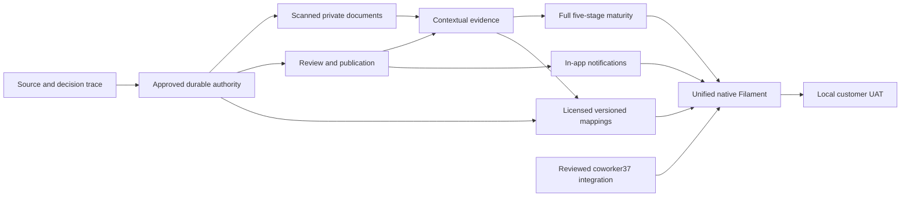

# Dependency graph and independent work

Current independent subtask: source-confirmed immutable stage vocabulary and category range consistency. No DB, authorization, scale placement, workflow state or reassessment rule. Preserve configured order; variable category count; reject nonfinite/reversed/out-of0–100/overlapping bounds. No midpoint, score, average, automatic rating or unlock. It advances P7 internally but completes neither P7 nor J08/J09. Coverage-gap UI/precision semantics and persistent version snapshots remain separate reviewed work.

Next highest-value operational slice: minimal owner-ratified D-002 bootstrap/Approach grants then review/publication, requiring protected/schema approval. P3 independently needs D-007. #37 must not be duplicated or mounted before reviewed merge. See PROTECTED-CHANGES for dependency surfaces, not authorization.
