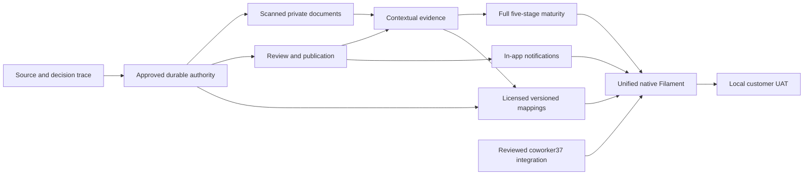

# Dependency graph and independent work

Accepted independent subtask #51: immutable stage vocabulary/category range consistency, merged PR52 with exact-main CI. It advances P7 internally but completes neither P7 nor J08/J09. Coverage-gap UI/precision semantics and persistent version snapshots remain separate reviewed work.

Accepted subtask #53/PR54: J01 identity browser-to-MySQL verification,45 browser checks/readback, merged main27c5b5e with CI42640302018 SUCCESS524/5488. No roles/Policy substitution or overall-phase completion.

Current Issue55 package: confirmed private owner source, received responsibility reconciliation, actionable matrix, selected J03_LOCAL_APPROACH_001 TEST_ONLY fixture and exact36-path/schema/current-read/locking/test proposal. Engineering lead expressly requested review before file approval. No local A–E question remains; no operational owner ratification or implementation approval follows.

Next executable code depends on that exact review and applicable owner gates. Full J03/review/publication remains separately gated. P3 needs D-007; P7 needs D-003/D-014; #37 must not be duplicated/mounted before reviewed merge. See ISSUE-55-CLOSURE-GATE.md. Do not repeat J01 or generate further planning-only cycles while the concrete scope awaits approval.
