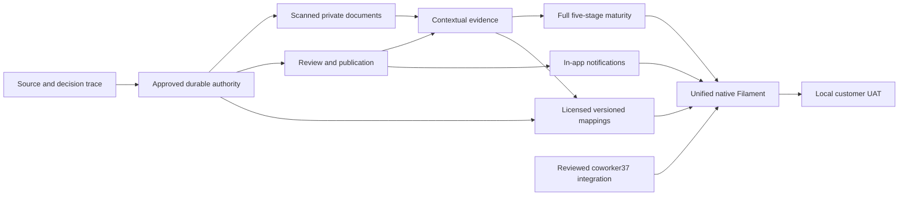

# Dependency graph and independent work

Accepted independent subtask #51: immutable stage vocabulary/category range consistency, merged PR52 with exact-main CI. It advances P7 internally but completes neither P7 nor J08/J09. Coverage-gap UI/precision semantics and persistent version snapshots remain separate reviewed work.

Current independent subtask #53: real J01 identity browser-to-MySQL verification,45 browser assertions and persisted readback, no roles/permissions or Policy substitution. L3 for the existing candidate is verified locally; independent review, exact-head CI and owner/source acceptance remain distinct. It completes no overall phase.

Next highest-value operational slice: bounded owner-ratified Approach entry/list/create/edit/history authority and durable assignments, then separately approved review/publication. See NEXT-APPROACH-AUTHORITY-GATE.md for the minimum issuer/resource/lifecycle rows and required versus conditional protected/schema approvals. P3 independently needs D-007. #37 must not be duplicated or mounted before reviewed merge. PROTECTED-CHANGES lists dependency surfaces, not authorization.
