# Real documents and historical reassessment — independent foundations

Issue [68](https://github.com/NabilAlsaidaly/quality-excellence-platform/issues/68),2026-11-11. Branch: `feat/mvp-completion-2026-11`. Baseline protected main: `90894051f249fe9b8aa78af728580bf96ddd9299`; [postmerge42993242057](https://github.com/NabilAlsaidaly/quality-excellence-platform/actions/runs/42993242057) SUCCESS verified before ff-only synchronization. PR67's accepted readiness work, four worktrees, existing owner demo and development database were preserved. No reset, branch replacement, force push, deployment or self-merge.

## النتيجة التنفيذية

نُفذت مكونات مستقلة تعمل على بايتات فعلية: فحص PDF/DOCX، وحجر خاص مع بصمة وإيصال ثابت، ومحوّل تدفق ClamAV يرفض الفشل والرد الغامض، وتاريخ تقييمات غير قابل للاستبدال، وحساب اختباري صريح لأثر خفض التصنيف وإعادة التحقق المتسلسلة. هذه المكونات غير موصولة بمسارات أو منح أو واجهات تشغيلية. الميزتان الكاملتان **غير مقبولتين بعد**: الترحيلات والتكامل المحمي قيد المراجعة قبل الاعتماد، ولا يوجد ماسح ClamAV فعلي مثبت أو فحص ملف عميل مثبت.

## Authority, requirements and status

The latest execution request authorizes independent implementation while requiring exact protected-path/DDL review. The subsequent Lead reply selects **REVIEW BEFORE APPROVAL** for the complete R01–R26 package; C01–C21 remain excluded unless explicitly selected. Neither the six proposed migrations nor those protected integration paths were executed/edited. Complete authoritative contracts, source receipts, bounded fixture decisions and full SQL remain private inside the project.

Bounded D007/D014 parameters were received from the Lead for TEST_ONLY execution; they are not operational Product Owner ratification. Settled responsibilities, no self-approval, immutable evidence/version history and fail-closed scanning were not reopened. Normal D002, operational D007/D014, D003 placement, T17/58/61 and coworker37 boundaries remain. The old synthetic workspace assignments were not reinterpreted as real upload/download/release permission.

| Classification | Current evidence / limitation |
|---|---|
| DOMAIN_VERIFIED | PDF/OOXML inspection, private-byte receipt integrity, scanner protocol failure handling, immutable assessment history and explicit bounded D014 dependency calculation |
| DATABASE_VERIFIED | Existing MySQL regression only:250 tests/3024 assertions. New intake/reassessment persistence is **NOT VERIFIED / NOT EXECUTED** pending approval |
| BROWSER_VERIFIED | **Not for the new features**: no new privileged UI/endpoint was activated. Existing accepted owner-demo interfaces remain unchanged |
| SECURITY_VERIFIED_WITHIN_SCOPE | Actual malicious-structure negatives, archive limits/no extraction, receipt relabelling/corruption refusal, Windows ACL/POSIX privacy checks and transport failure tests; no global T17 claim |
| OWNER_DECISION_PENDING | Customer-operational policy ratification remains separate; the received bounded D007/D014 choices are settled and must not be asked again |
| OPERATIONAL_AUTHORIZATION_PENDING | No production/customer grants, file serving, real release, privileged routes or reassessment activation |
| NOT_ACCEPTED | Full real upload→scan→independent release→exact-version download and persistent native reassessment/downstream workflow |

FR/AC references: DOC001–003/007–011/013–014, MAT015–016/020, REV003–010/013 and UX005–006. Existing full acceptance rows remain unchanged. An engineering approval does not fill missing operational business policy.

## Implemented paths and responsibilities

All PHP changes in this slice are **new independent files**. Existing Actions, Models, Policies, authorization services, routes/providers, migrations, package manifests/locks, CI, themes and coworker files remain unchanged.

| Paths | Responsibility |
|---|---|
| `app/Domain/Documents/Intake/DocumentInspectionLimits.php` | Explicit technical bounds; approved TEST_ONLY decimal cap30,000,000 bytes/version; expanded archive/entry budgets explicitly supplied |
| `app/Domain/Documents/Intake/InspectedDocument.php`, `QuarantinedDocument.php` | Structural metadata/digest and internal private-storage receipt; neither grants access nor represents release |
| `app/Domain/Documents/Intake/DocumentMalwareScanner.php` | Stream scanner contract reusing existing ScanResult |
| `app/Services/Documents/InspectDocumentFile.php` | Actual MIME/size/hash and conservative PDF/OOXML structural screening; legacyDOC refused |
| `app/Services/Documents/QuarantinedDocumentStore.php`, `QuarantineDirectoryPrivacy.php` | Exclusive random scoped keys, real streamed copy/fsync/durable receipt, corruption refusal, owned-attempt compensation and actual OS privacy verification |
| `app/Services/Documents/ClamdStreamScanner.php` | Explicit trusted local socket, bounded deadline/framing/read-to-EOF and strict verdict parsing; unregistered/unconfigured |
| `app/Domain/Maturity/StageAssessmentHistory.php` | Typed append-only lineage/comparison, exact replay, stale/foreign/reused approval refusal over ApprovedStageAssessment |
| `app/Domain/Maturity/TestOnlyReassessmentDependencies.php` | Opt-in calculation over the accepted complete five-stage fixture and exact historical StageSubmission; no database write, grant or initial-engine replacement |
| `tests/Feature/Documents/{DocumentFormatInspectionTest,QuarantinedDocumentStoreTest,ClamdStreamScannerTest}.php` | Real format/storage/protocol positives and adversarial/OS/failure cases |
| `tests/Unit/Maturity/{StageAssessmentHistoryTest,TestOnlyReassessmentDependenciesTest}.php` | Historical preservation, lineage, category/configuration identity, stale/foreign denial and sequential dependency cases |
| `tests/Support/{HarmlessDocumentSamples,PrivateIntakeTestDisk,ClamdProtocolPeer,MaturityAssessmentSamples}.php` | Generated harmless files, exclusively provisioned test disks, explicit protocol peer and domain samples; no fake actual-scan acceptance |

Public engineering records: this report, [68.md](68.md) and delivery STATUS/RESUME checkpoints. Exact containing commit, Draft PR and final-head CI belong to the final private receipt/PR metadata after they exist; no identifier-only commit is required.

## File flow, privacy and scanning

```mermaid
flowchart LR
    A[Actual PDF or DOCX bytes] --> B[Bounded structural inspection]
    B --> C[Exclusive private quarantine and digest receipt]
    C --> D[Verified internal scanner stream]
    D --> E[Unregistered ClamD adapter]
    E --> F[Clean / suspect / unavailable evidence]
    F --> G[Remains inaccessible]
    G -. protected approval pending .-> H[Durable processing and independent human release]
    H -. protected approval pending .-> I[Current Policy exact-version download]
```

The validator measures actual bytes and type; browser MIME is not trusted. DOCX parsing checks central-directory bounds and actual expanded bytes/CRC, rejects unsafe/duplicate paths, macros/embedded objects/executable parts, encrypted/unreadable streams, malformed XML/DTD/entities and external relationships. It never extracts an archive. PDF screening is an explicitly conservative classic-xref subset; it is **not a complete PDF parser, sanitizer or CDR**. Valid unsupported PDFs/OOXML variants may be refused. Do not claim full format compatibility from these fixtures. [OWASP upload guidance](https://cheatsheetseries.owasp.org/cheatsheets/File_Upload_Cheat_Sheet.html) supports layered validation, private storage and separate access control; [PHP ZipArchive](https://www.php.net/manual/en/ziparchive.statindex.php) supplies entry metadata used with independently measured stream bounds.

Quarantine uses an explicitly provided canonical private local disk outside public storage, validated ULID scope and random exclusive storage identities. Copying is bounded again before finalization; digest/size are verified after storage and before internal scanner reads. Client filenames never become storage paths. Sidecar receipts contain no release authority. On a synchronous failed attempt only its owned files are compensated. Process-crash/ambiguous-commit reconciliation across SQL/files remains **pending protected persistence work**; no orphan is silently adopted or historical file deleted.

The first Windows test exposed that Flysystem's POSIX visibility result does not establish NTFS privacy. The implementation now checks provisioned owner/SYSTEM-only ACLs read-only on Windows; POSIX roots must exclude group/other access. Tests provision only their fresh random empty disk. No global ACL/PHP setting is changed. Actual stored-file ACLs are checked in the test, preserving the privacy guarantee rather than changing an expected string to conceal the platform issue.

The adapter follows [ClamD INSTREAM](https://docs.clamav.net/manual/Usage/ClamdProtocol.html): local endpoint only, NUL framing, big-endian length chunks, bounded total bytes/time and complete reply through EOF. Only the exact clean response yields Clean; suspect/error/truncation/additional records/timeout/closed connection fail closed. Stream position is restored and the socket is closed. No real engine/signature service is installed/configured here. An actual loopback protocol peer verifies transport and received SHA/size; it is explicitly **not antivirus** and cannot justify release or browser acceptance.

## Historical reassessment boundary

History wraps the existing immutable ApprovedStageAssessment/ReviewSnapshot contract with supplied trusted assessment identities, explicit attempt/prior links, optimistic previous-record check and exact replay. It does not select an effective assessment or authenticate anyone.

The separate opt-in TEST_ONLY dependency projection binds exact original configuration/questions/ordered scale and submitted answers to independent approved review fingerprints. A lower category marks later stages for revalidation; approvals cannot skip an unrevalidated prerequisite. Sequential independent approvals clear their own requirement while preserving other outstanding flags. Higher/equal categories do not change downstream ratings or silently clear earlier outstanding revalidation. No score, mean or percentage is computed. Original InitialMaturityCycle objects/assessments stay unchanged. The current independent calculation supports the complete five-stage acceptance fixture; partial initial cycles fail closed as unsupported in this slice. This is a technical limitation, not a new customer eligibility rule.

Pending/correction does not enter the approval projection. New persistent attempts, exact original-configuration selection, explicit evidence reselection/current release and contextual adequacy checks, effective-state SQL, audit/notifications and native UI remain in the protected review package. No actual reassessment transition was activated by these domain tests.

## Actual verification and failures

| Check | Result |
|---|---|
| Initial format/store RED |21 tests:4 missing-class errors/17 failures before implementation |
| Initial scanner RED |8 missing-class errors; fixture peer explicitly not AV |
| History/dependency RED |Corrected fixture construction before recording missing-class RED; no original contract changed |
| Final full SQLite |**482 tests /4484 assertions PASS** |
| Full isolated MySQL8.4.13 |**250 tests /3024 assertions PASS**, including existing two-connection RR/concurrency/rollback suites; no new proposed DDL executed |
| Real isolated Redis8.2.11 |**4 tests /19 assertions PASS**, exact-owned container cleanup, DB14/15, no FLUSH |
| Total backend suites |**736 tests /7527 assertions PASS**;46 additional independent tests/145 assertions beyond the baseline SQLite suite |
| Composer validate --strict / platform / audit |PASS; no advisories or abandoned packages |
| Repository Pint --test |PASS; only new files were formatted |
| npm ci / build |PASS with unchanged lockfiles. Build output isolated privately so the live public manifest/assets remain unchanged |
| Read-only existing browser control |12 checks PASS at375/768/1280: original Arabic fields/CSRF/native components/RTL and unauthenticated workspace redirect; no credentials or privileged actions used |

Recordable setup failures: initial Composer commands inherited an unwritable global temp path; rerun used per-process sys_temp_dir inside the project, without php.ini changes. First isolated npm command lost its outDir flag through the PowerShell wrapper and failed to resolve an entry; npm.cmd with the explicit forwarded option passed. Original logs remain private. The Windows privacy failure and fixture-constructor mistakes were fixed explicitly, not counted as passing runs. No old test/negative assertion was removed or weakened.

A meaningful additional RED case showed that an inconsistent original category order could be misread as a lower/higher rank. The bounded calculation now refuses that input instead of sorting history or guessing a ranking; the negative case and final complete SQLite rerun pass. Same-scale equality alone is not considered sufficient proof of a reliable order. npm emitted its existing install-script policy warnings; no script approval/global setting was changed and the isolated build succeeded.

The existing owner demo, its database/credentials/24h expiry and normal environments remain outside these regression fixtures. Test MySQL/Redis containers were new, labeled, loopback-only and identity-verified; their cleanup removed only owned exclusive resources. No development quality_platform reset/migration or unapproved source/SQL operation occurred.

## One consolidated review package and next executable step

The complete owner-private `PROTECTED-PERSISTENCE-AMENDMENT.md` contains all26 required paths and21 conditional paths, complete MySQL/SQLite SQL for six proposed migrations plus conditional downstream-impact SQL, composite tenant/user/version keys, CHECK/UNIQUE/index semantics, transaction/lease/current-authorization ordering, idempotency, recovery and populated rollback refusal. It incorporates the received TEST_ONLY D007/D014 decisions and explicitly distinguishes operational ratification, technical scope approval and compatibility-only changes.

R01–R26 remains REVIEW BEFORE APPROVAL; no R migration/model/Action integration or protected R17 edit was performed. C paths remain excluded; C15–C18 need actual compatibility failures after approved schema changes, and none is currently justified by the passing baseline. Existing synthetic assignment operation constraints cannot silently authorize real file privileges; exact grant-schema/admission dependencies remain disclosed and unapproved. Review approval must select exact paths, not imply global authority.

After explicit approval, the immediate executable work is fail-first disposable SQL/constraint/recovery proof, then the smallest approved Document/Version and reassessment persistence integration. Privileged file/reassessment UI and real-scanner browser acceptance require the corresponding exact technical scope. Full Feature A/B remain **PARTIAL / NOT_ACCEPTED** until their real authorized browser→storage→MySQL workflows and independent release/downstream outcomes are verified. Issue62 stays open; no deployment or self-merge.

## Independent CI and preservation checkpoint

Implementation commit `fccb4d5978cd7804cd68a1465805a6df9e386ef5` is published in [Draft PR69](https://github.com/NabilAlsaidaly/quality-excellence-platform/pull/69). Actual [Foundation43015391503](https://github.com/NabilAlsaidaly/quality-excellence-platform/actions/runs/43015391503), job130505044211, completed SUCCESS: SQLite482/4484, MySQL250/3024 and Redis4/19 =736/7527; Composer/platform/audit, Pint310 files, npm/build/runtime PASS. The independently read logs identify Node24.22.2 and zero npm vulnerabilities. Checkout was `f6d613cf66890ee15c60e8eed85c4f630673cf48`; its tree45382fa18a6ea74b0b4bd5e74e9e3ee2dc062740 equals the implementation tree, with exactly the reviewed main9089405 and featurefccb4d5 parents.

Publication audit verifies23 exact paths, no private fixture values and zero gitleaks findings. The full private review package contains26 R/21 C unique paths and14 SQL blocks; no proposed SQL was executed. Four clean worktree refs, the existing owner-demo response identity/frozen source hashes, original PHP process identity, normal.env and public asset manifest were checked and retained. New regression containers alone were cleaned through scoped ownership/UUID/volume guards. These are independently obtained CI/preservation facts, not operational acceptance or a new protected-scope approval. This documentation checkpoint also requires SUCCESS for its containing final HEAD; that distinct receipt is kept in PR69/private handover without an identifier-only follow-up commit.
